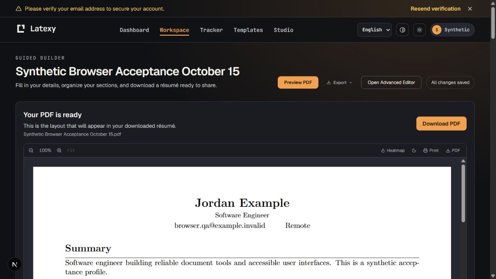

# Renderer and guided-builder acceptance — October 15, 2026

Production launch remains **HOLD**. This dated record distinguishes completed
isolated acceptance from production certification, migration and deployment.
It supplements the [October 14 record](../../dodo-live-2026-10-14/READINESS.md);
it does not rewrite that record's failed or incomplete attempts.

## Sources and repairs

| Scope | Actual tested source | Meaning |
|---|---|---|
| Renderer profiles, shipped templates and bridge | `14684c499d60e9e1d2d68ad78e1e4eecb1bda0a9`, backend tree `746072cab6f70f57d1f597d0ba4dd0d27772cd7f` | Frozen source before final entitlement integration. |
| Owner API and browser | `fa22e002380982faaa772c7f541e3ba6dbc96094`, backend tree `d3f7c4390090038f7d54e9d253944f5a8775dc5c`, frontend tree `407d6a84826ac08370628cb147820cfa54e7dbef` | Actual isolated application run, including normal workers and private artifacts. |
| Fresh read-only production rollout diagnostic | `f77de0bdc6b9e9ebe28403964d632e5752f134d4` | Includes main's mobile landing changes from #1893; backend tree unchanged from `fa22e002`. This diagnostic does not attest serving source. |

[PR #1895](https://github.com/sanskarpan/Latexy/pull/1895), merged as
`482a9b179fc3fb9b27bfb641412fa94e040ed170`, reserves 2 GiB for the renderer VM
while retaining the existing 2 GiB cap. A paired experiment observed a kernel
OOM record matching the Lua process at 1 GiB; the same document passed at 2 GiB.
This is bounded diagnostic evidence, not a general capacity or latency SLO.

[PR #1896](https://github.com/sanskarpan/Latexy/pull/1896), merged as
`a03ca9dec115199550ae1c6eccd544bfddb192b0`, repairs Chinese/Korean italic font
configuration and the Hindi/Marathi Babel commands used by generated documents.
The final acceptance below was rerun after those repairs. PDF presence alone was
never treated as success after a compiler error or missing-font warning.

[PR #1894](https://github.com/sanskarpan/Latexy/pull/1894), merged as
`2c8aaa01197ca48c7850ca0e1ddd94f94c1df226`, supplies a feature-only
entitlement request, preserving authentication, effective grants and the existing
fail-closed timeout. It also incorporates the saved-version conflict wording
from commit `9630bc5b`; duplicate #1897 was closed. The copy repair preserves
version checks and draft recovery and does not establish the cause of earlier
transport interruptions.

All canonical checks passed on exact integrated candidate `f77de0bd`, including
[Cross-Browser Quality and Isolated Real Compile and Preview](https://github.com/sanskarpan/Latexy/actions/runs/38768229282).
The squash merge's complete root tree matches the tested candidate:
`95bd4383fbc98e9fd22b672a712babdaa1c0b5f5`. This records source equivalence at
merge time, not production deployment. Its frontend tree includes #1893 and
differs from the earlier `fa22e002` browser snapshot.

## Account-menu follow-up

A later [canonical CI run](https://github.com/sanskarpan/Latexy/actions/runs/38773429241)
on evidence head `1fd71318` failed the mobile WebKit sign-out case with an
unclassified speculative `/byok` load refusal. Its quality matrix recorded
179 passes, 10 skips and that one failure. The runtime sources were unchanged
from the earlier green `f77de0bd` run; the failed attempt remains evidence and
is not reclassified as a pass.

The follow-up disables automatic prefetch on transient mobile/account menu
links. Normal destination clicks, capability visibility, focus behavior and
sign-out remain intact. This avoids initiating menu-owned speculative work
that can race document replacement, at the cost of fetching an uncached
destination when it is selected. The strict WebKit error classifier is
unchanged. Regression checks cover all 18 menu links, require zero recorded
menu prefetches across sign-out, and exercise actual Terms-link navigation.
Focused source/session/provenance tests pass; final browser acceptance belongs
to the final PR revision's canonical checks, separately from the earlier
owner/browser execution record below.

## Actual renderer results

The [renderer execution record](renderer.json) binds the intended immutable bare
image, actual asset fingerprint, support-file hashes, requested limits,
fixture/output hashes, quality checks and terminal cleanup.

All 27 recorded support-hash entries across 17 unique files match both the frozen
renderer checkout and `f77de0bd`. The intervening backend differences are
`app/api/routes.py` and two entitlement test files. That byte comparison supports
reuse of the renderer evidence; it does not attest the changed route behavior or
claim equality of the complete backend trees.

The operator uploaded Windows CRLF source bytes; `support_sha256` records those
actual bytes, verified in the remote function. `checkout_provenance` also records
the canonical LF Git-blob SHA-256 values for all 17 files. Removing CRLF line
endings reproduces those Git blobs exactly, and their parsed Python ASTs match.
This makes the source comparison reproducible without claiming that a later
Linux build or serving deployment was exercised by the Windows operator run.

| Run | Result | Scope |
|---|---|---|
| Representative profile matrix | 15/15 passed | Five builder categories, Chinese variants, Japanese, Korean, Hindi, Marathi, Arabic, Hebrew and two mixed-script profiles. |
| Shipped templates | 61/61 passed | LuaLaTeX, two passes per template, valid PDFs, font-quality checks, recorder confinement and SyncTeX. |
| Actual bridge | 4/4 passed | LuaLaTeX/BibTeX convergence, pending cancellation, bounded wait, and the original absolute session deadline with expired-session rejection. |

These runs used the production bridge's 2 GiB VM configuration, without bound
secrets, mounted volumes or network access. Every recorded VM reached a terminal
cleanup state. This is not three-compiler coverage or proof of all possible
documents, language extraction behavior, application paths or production load.

The first shipped-template run compiled its documents but failed the harness's
recorder check: it compared the operator's temporary directory with the VM's
namespace. The correction checks the bridge-reported remote workspace. The
passing second run retains the same image, source and confinement policy. The
earlier run remains a failed harness attempt. Earlier multilingual fixture and
production-command failures are also retained separately from the final pass.

## Normal owner and browser flow

The [owner/browser record](owner-browser.json) covers one small synthetic saved
résumé, using the stored LuaLaTeX default and normal admission, quota and workers.
The initial submission response timed out after 15 seconds, but the job had been
admitted. GET-only recovery found and verified that completed job; it did not
submit it again. Compilation quota moved from 0 to 1 and stayed unchanged during
recovery.

Normal and immutable PDF downloads matched the job manifest. Source/document
identity, geometry and SyncTeX were checked. A second owner received 404 for the
tested résumé and immutable PDF, geometry and SyncTeX endpoints. This does not
claim exhaustive authorization coverage for every job/result route.

The browser reloaded the saved profile with all changes saved, requested a
second normal preview, painted its PDF, exercised zoom/fit and downloaded the
93,093-byte PDF. Its hash, byte count, source, document, job and actual LuaLaTeX
compiler matched the completed job's manifest. Earlier request interruptions
remain unexplained by this successful flow.

The QA assembly omitted periodic schedules because of the workspace function
limit; it registered the actual API and unscheduled worker callables with their
source images and resources. It used an expiring restricted QA database role
and temporary isolated Redis/private object storage. Production credentials and
the separate backup Redis instance were not used. The local services and owned
temporary cloud applications were confirmed stopped after acceptance.

## Production rollout state

The [fresh public rollout envelope](rollout-preflight.json) reports
`safe_to_rollout=true`, `sales_state=safe_disabled`, no reasons and
`live_sales_acceptance=unverified` for source `f77de0bd`. Its source fingerprint
matched the local candidate; the [local comparison record](rollout-review.json)
retains the execution time and binds the exact public envelope by SHA-256.
This read-only decision is distinct from the normal
billing-readiness report, which correctly blocks disabled sales and the known
pre-migration database revision `0059`.

The migration path through `0075` was rehearsed on isolated Neon copies. No
production migration or serving deployment was performed by this acceptance.
The existing recovery snapshot was preserved and a separate current recovery
point was prepared. Its identity, retention and operational details remain in
private operator evidence. Preparing a recovery point is not a restore drill.

Remaining release gates include separate authorized certification of the exact
renderer boundary, durable production configuration, final reviewed-source
workflow checks, migrations and verification of the actual serving deployment.
Keep [#1865](https://github.com/sanskarpan/Latexy/issues/1865) and
[#1866](https://github.com/sanskarpan/Latexy/issues/1866) open until their remaining
criteria are met. Keep the renderer production gate and live-sales assertion
closed while required evidence is absent.

Live sales and the provider webhook remain disabled. No live payment,
cancellation or refund was executed. Student checkout remains pending at the
owner's request. This record does not approve a paid launch.
