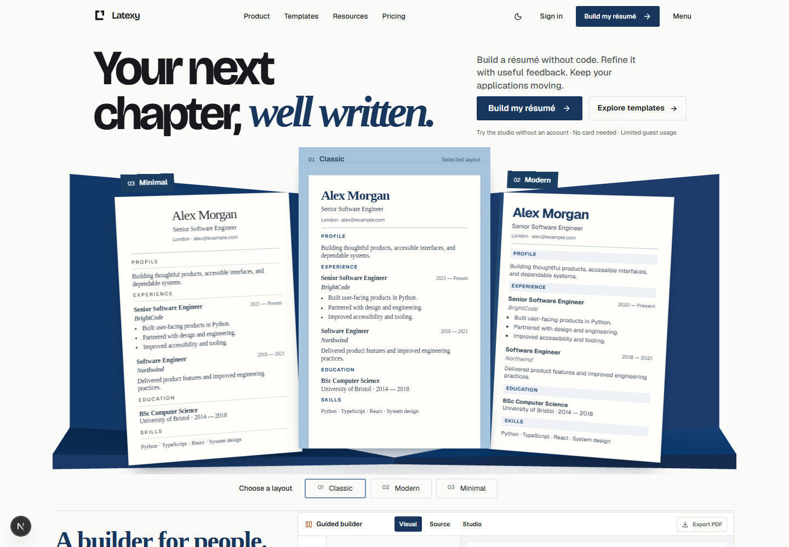
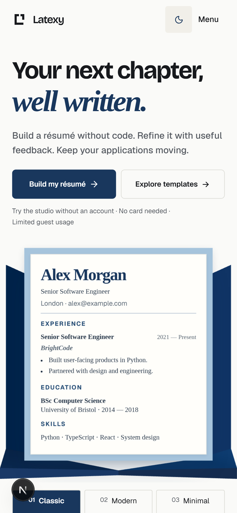
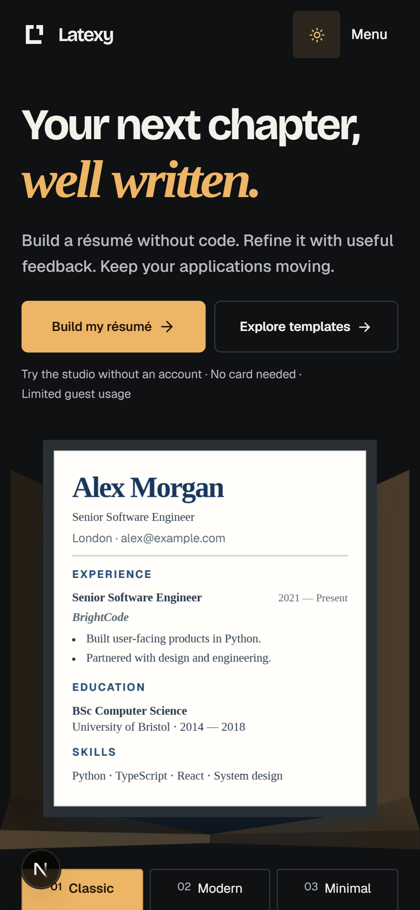

# Landing review evidence

Actual browser screenshots captured after source commit `5bbf7fa80dd4f924c392fc0c75768f81e07a6715`.

- Source frontend tree: `de1c3ded008dd226dfb446322068e4563166e575`.
- Local Next development preview; the small Next development indicator is visible. It was not edited out. These are not generated mockups or screenshots of the reference image.
- Anonymous HTTP fixtures supply product access; all sample documents are synthetic.
- Desktop: 1440 × 1000 CSS viewport, 1x density. Full-page images preserve the original screenshot. `hero-*.png` are the top 1000px cropped from those actual full-page screenshots.
- Mobile first screens: 320/390/430 × 844 CSS viewports at the Pixel 7 device density. Full mobile pages use the project's Pixel 7 viewport.
- `provenance.json` records original pixel dimensions and SHA-256 digests.
- Source/render comparisons and the section review are described in the root `design-qa.md` on this evidence branch.

The Linux production frontend build and Vercel deployment passed for this source commit. The full cross-browser and real-compile CI jobs were still running when this evidence was prepared. Keeping the review files on a separate evidence branch avoids cancelling those source checks.

## Desktop

## Phone

